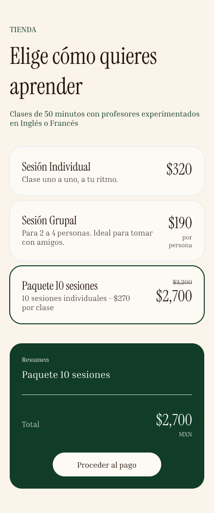

# 4. Refinamiento y escenarios
> Ejercicio 4 · Tema 7 · 🎩 PO y 🎩 desarrollador
> Los escenarios BDD van en la carpeta `features/`.

## 4.1 Pesar (MoSCoW)

Criterio que usé: Asigne los valores Must a todo lo que Sofia necesita para trabajar, Should para todo lo que agrega valor suficiente, Could para todo lo que facilitaria el uso de la app pero no se pierde nada sin ellos y Won't para lo que podemos dejar para después 

## 4.2 Ilustrar

Historia: #8
Boceto:

Prototipo en Figma: https://www.figma.com/design/tprlDYpP7PtqvLQuJxaTGJ/Lingo?node-id=1-2&t=gReJDp3NJe3znNuT-1 

## 4.3 Medir

Escala de puntos: 1, 2, 3, 5, 8, 13, 21.

## 4.4 Dividir

- **Velocidades de referencia de mi variante:** 18, 20 y 16 puntos
- **Operación:** (18 + 20 + 16) ÷ 3 = 18; 18 ÷ 2
- **Carga máxima por historia:** 9
- **Historias que rebasan la carga máxima:** #5, #10, #14 y #15

| Historia original | Puntos | Subhistorias (issues) | Puntos de cada una | ¿Cómo la partí? |
|---|---|---|---|---|
| #10 | 13 | #18 , #19 | 5 y 8 | Visualización del calendario en dias y horas y compra desde el horario |

## 4.6 R2 como tabla FIT

> Escríbela antes de programar. Al terminar el Ejercicio 6, agrega la columna "Resultado real" y marca cada fila: ✅ si pasó, ❌ si falló (con el valor esperado y el real).

| (entrada) | (entrada) | Resultado esperado | Resultado real |
|---|---|---|---|
| 24 | reprograma | cargo $0 | ✅ |
| 23 | reprograma | cargo $80 | ✅ |
| 4  | reprograma | cargo $80 | ✅ |
| 3  | pierde     | cargo $0 | ✅ |